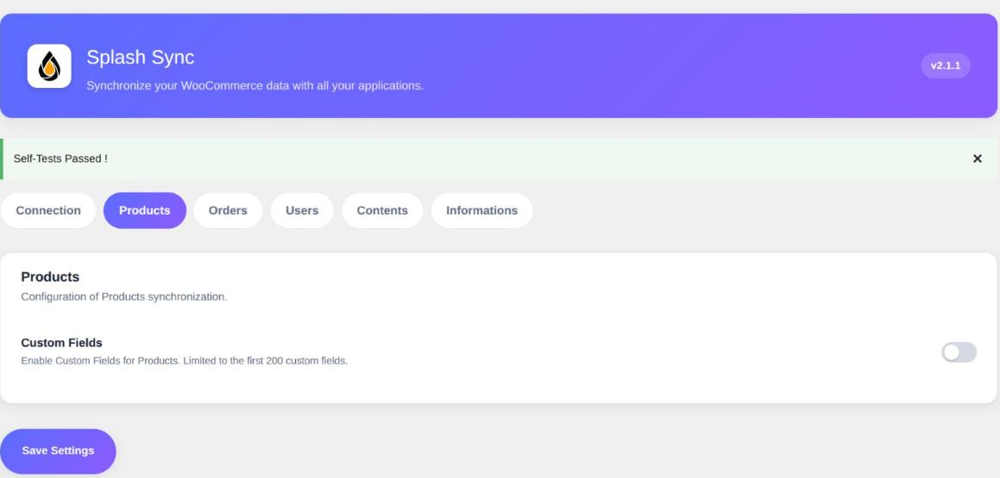

The **Products** tab holds the custom fields options, and they deserve an explanation: the same
mechanism comes back on orders, invoices, posts and pages.



### Custom Fields

> Enabled by default.

WordPress stores a good part of its data as *post meta*: a free-form value attached to a
content, identified by a key. Your plugins create them all the time — a lead time, a supplier
code, a regulatory notice.

When this option is on, Splash exposes those values as extra fields on your products, **in
read and write**. They become mappable from your Splash workspace, exactly like the price or
the stock.

Three rules decide what shows up in the list:

- **Protected keys are skipped.** That is the WordPress convention: any key starting with an
  underscore (`_purchase_price`, `_wc_...`) is considered internal and is never exposed.
- Splash's own technical keys (`splash_id`, `splash_origin`) are skipped too.
- Unless you select the keys to expose (see below), the list is capped at **200 keys** found on
  your products and their variations. Past that cap, the **first keys in alphabetical order are
  dropped**, and a warning listing them is logged each time Splash reads the object description.

> [!NOTE]
> The list is built from the keys that actually exist in your database, not from one particular
> product. A key used by a single product will therefore show up on every other one, simply
> empty.

> [!TIP]
> When a field you expect does not appear on the Splash side, it is almost always one of those
> three rules: protected key, cap reached, or a key missing from the database because no
> content carries it yet. Selecting your keys settles the last two.

##### Should you leave it on?

Yes, most of the time: this is what brings in the data your plugins write, with no development
at all. Turn it off when your site piles up hundreds of technical keys with no business value —
you will lighten the object description exchanged with Splash by as much. Or keep it on and
select only the keys you map: the description stays light, and nothing is dropped behind your
back.

### Custom Fields Selection

> Empty by default: every key is exposed, up to the cap.

Rather than letting the cap decide, list here the keys you want to expose, **one per line**:

```
supplier_code
acf_*
!acf_tmp_*
```

- `supplier_code` — an exact key. It is exposed **even before any product carries it**, so your
  Splash mapping does not depend on the content of your catalogue.
- `acf_*` — every key found that starts with `acf_`. The `*` wildcard can stand anywhere
  (`*_gtin`), and `*` alone selects every key found.
- `!acf_tmp_*` — an exclusion: matching keys are never exposed, even if another line selects
  them.
- Lines starting with `#` are comments.

As soon as one key or pattern is selected, **only those keys are exposed and the cap no longer
applies**. A list made only of exclusions just hides keys: the cap still applies to the others.
Protected keys stay hidden in every case; WordPress's own `is_protected_meta` filter is the way
to open one.

Sites that prefer code can set or complete the same rules with the
`splash_custom_fields_selection` filter, which receives the rules and the object type
(`product`, `order`, `invoice`, `post`, `page` or `user`):

```php
add_filter('splash_custom_fields_selection', function (array $rules, string $objectType): array {
    if ('product' === $objectType) {
        $rules[] = 'acf_*';
        $rules[] = '!acf_tmp_*';
    }

    return $rules;
}, 10, 2);
```
