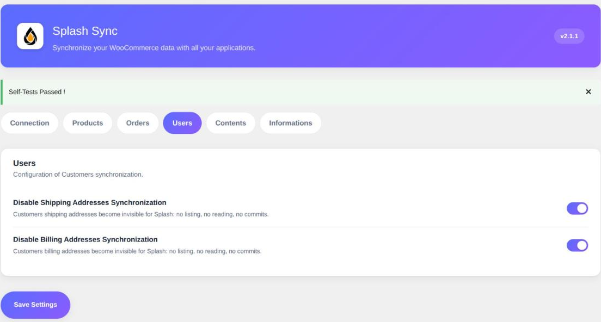

The **Users** tab does not drive the accounts themselves — they are always synchronized — but
the **addresses** attached to them.

WooCommerce gives every customer two addresses: a billing one and a shipping one. Splash
exposes them by default as two distinct **Address** objects, in read and write, so that an ERP
can read and correct them.

The two options below exist to close one of them, or both.

### Disable Shipping Addresses Synchronization

> Off by default: shipping addresses are therefore synchronized.

Tick this box to make your customers shipping addresses **completely invisible to Splash**: no
listing, no reading, no change reported.

### Disable Billing Addresses Synchronization

> Off by default: billing addresses are therefore synchronized.

Same thing for the billing side.

> [!WARNING]
> Mind the direction of these two options: they **disable**. An unticked box means
> synchronization is active — the opposite of the Orders tab options, which enable. This is
> deliberate: the plugin's historical behaviour is to synchronize everything, and an update
> must never cut off a synchronization already in place.

### When to use them

**Your shop does not ship.** Services, digital goods, in-store pickup: shipping addresses are
empty or fanciful. Cutting them off keeps worthless records out of your ERP.

**Your ERP owns the addresses.** When addresses are managed elsewhere and flow down to
WooCommerce, you may prefer the site not to expose them at all, rather than arbitrating the
synchronization direction field by field.

**Volume and GDPR.** Fewer addresses exposed means less personal data travelling, and one less
object to list on a high-volume site.

> [!NOTE]
> The email address of a shipping address is always the one of the customer account, and stays
> read-only: WooCommerce stores no shipping-specific version of it. Only the billing address
> owns its own, editable email.

### Users Custom Fields Selection

> Empty by default: every user meta key is exposed.

Customer accounts also carry *user meta*, exposed as extra fields on the customer. Every key
found on the site is exposed, protected keys, Splash keys and the names and addresses already
mapped aside. List here the keys you want to expose instead, one per line, with the same syntax
as on the **Products** page: `loyalty_*` selects by pattern, `!session_tokens` excludes a key.
The `splash_custom_fields_selection` filter receives them with the `user` object type.
